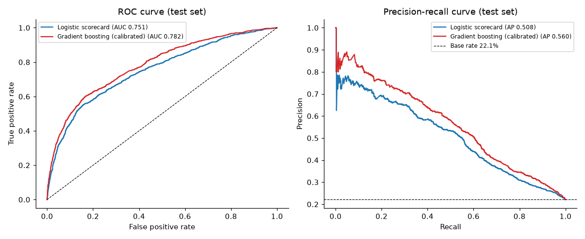
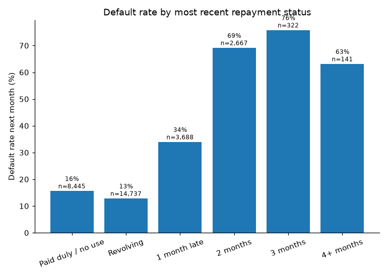
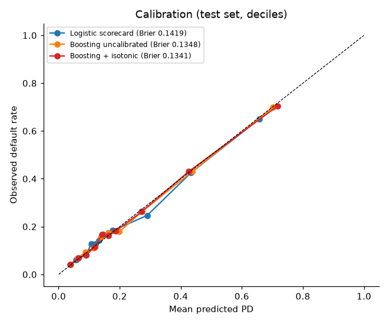
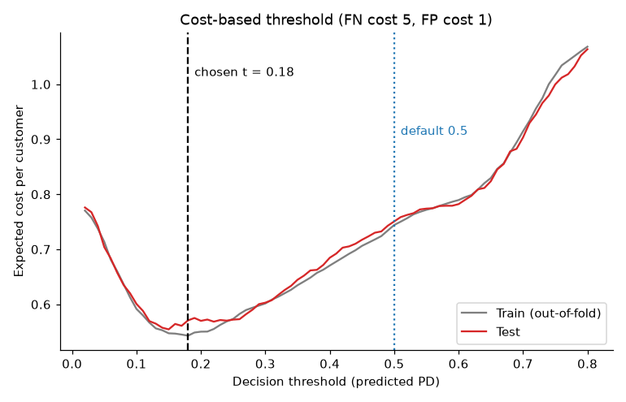
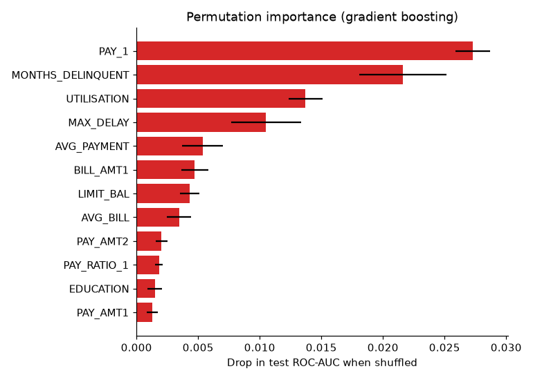
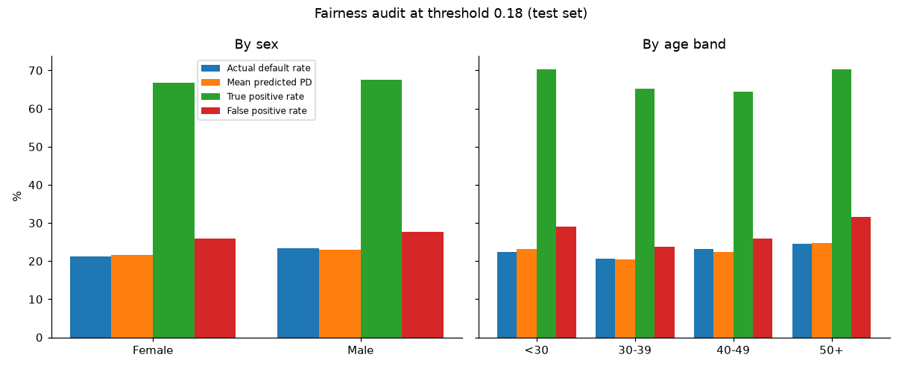

# Credit card default risk: scorecard vs gradient boosting, served as an API

Predicts whether a credit card customer will **default on next month's payment**, using the public UCI
*Default of Credit Card Clients* dataset (30,000 customers in Taiwan, 2005). The project goes from raw data to a
deployable model: a logistic-regression scorecard baseline against calibrated gradient boosting, a decision threshold
chosen by cost rather than defaulting to 0.5, permutation importance, a fairness audit by sex and age, and a
**FastAPI `/predict` service** with pydantic validation, pytest tests, a Dockerfile and GitHub Actions CI.

Author: Anthony Adusei-Poku ([@anthony07-max](https://github.com/anthony07-max))



## Key findings (stratified 80/20 split, 6,000 test customers, seed 42)

| Model (test set) | ROC-AUC | PR-AUC | Brier |
|---|---|---|---|
| Logistic regression scorecard | 0.751 | 0.508 | 0.1419 |
| Gradient boosting (uncalibrated) | 0.780 | 0.556 | 0.1348 |
| **Gradient boosting + isotonic calibration** | **0.782** | **0.560** | **0.1341** |

1. **22.1% of customers default**, so accuracy is misleading. A model that never predicts default is 78% "accurate".
   PR-AUC is reported next to ROC-AUC for this reason (a random model's PR-AUC is 0.22).
2. **Repayment history dominates.** Customers who paid on time last month default at 13 to 16%. Those 1 month late
   default at 34%, and those 2 months late at 69%. In permutation importance, the latest repayment status (`PAY_1`)
   and the engineered *months delinquent* count are the top two features. Credit utilisation is third.
3. **Gradient boosting beats the scorecard by 3.1 AUC points** (0.782 against 0.751) and lifts PR-AUC from 0.508 to 0.560.
   The scorecard is still competitive and fully interpretable. It is scaled to points (600 at 50:1 odds,
   20 points to double the odds): median defaulter 505 points, median non-defaulter 542.
4. **A cost-based threshold beats 0.5.** Assume a missed defaulter costs 5 times as much as wrongly referring a good customer.
   The threshold was tuned on out-of-fold *training* predictions and came out at **0.18**. On the test set it gives an
   expected cost of 0.571 per customer, against 0.751 at a 0.5 threshold (**24% lower**) and 1.106 when everyone
   is approved (48% lower). It catches **67% of defaulters** (891 of 1,327) at 42% precision and refers 35.6% of applicants.
5. **Calibration:** isotonic calibration keeps the predicted PDs honest (Brier 0.1341). Mean predicted PD matches the actual
   default rate to within about 1 percentage point in every sex and age group.
6. **Fairness check.** Sex is **excluded from the model inputs** and kept only for auditing. At the chosen threshold,
   true positive rates are almost equal (women 66.8%, men 67.6%). The flag-rate ratio, women to men, is 0.93, above the
   common 0.8 "four-fifths" screen. The bigger gap is by age. Customers aged 50 and over have the highest false positive
   rate (31.6%, against 23.8% for ages 30 to 39). This partly reflects their higher actual default rate (24.6% against 20.6%),
   but a lender should monitor it.

| | |
|---|---|
|  |  |
|  |  |



## The API
```bash
uvicorn api.main:app --reload            # http://localhost:8000/docs for Swagger UI
curl -X POST localhost:8000/predict -H 'content-type: application/json' -d @models/example_request.json
# {"probability_of_default":0.1309,"score":541.8,"decision":"approve","threshold":0.18}
```
- `GET /health` returns the model name and test AUC.
- `POST /predict` takes one customer and returns their PD, scorecard points and an approve/refer decision.
- `POST /predict/batch` takes a list of customers.
- The pydantic schema enforces valid ranges (age 18 to 100, education 1 to 4, repayment status -2 to 9, non-negative payments).
  It **rejects unknown fields**, including `SEX`, so the protected attribute cannot be passed in by mistake.
- `models/example_request.json` is a real row from the test set.

Docker:
```bash
docker build -t credit-default-risk-api .
docker run -p 8000:8000 credit-default-risk-api
```
CI (`.github/workflows/ci.yml`) installs `requirements-api.txt`, runs the pytest suite, then builds the Docker image.

## Data source and licence
- **Default of Credit Card Clients**, UCI Machine Learning Repository, dataset id 350:
  <https://archive.ics.uci.edu/dataset/350/default+of+credit+card+clients>. Licence: **CC BY 4.0**.
- Citation: Yeh, I. (2009). *Default of Credit Card Clients* [Dataset]. UCI Machine Learning Repository.
  https://doi.org/10.24432/C55S3H. Also Yeh, I.-C. and Lien, C.-H. (2009), *The comparisons of data mining techniques for the
  predictive accuracy of probability of default of credit card clients*, Expert Systems with Applications 36(2).
- The raw data is downloaded by `src/download.py` and is not committed to this repo.

## Project structure
```
src/download.py         # fetches the UCI zip into data/raw/
src/clean.py            # renames columns, recodes undocumented categories, writes data/processed/
src/features.py         # shared feature engineering + scorecard scaling (used by training and the API)
src/train.py            # models, CV, calibration, cost threshold, permutation importance, fairness, charts
api/main.py             # FastAPI app with pydantic request/response schemas
app/streamlit_app.py    # Streamlit dashboard + interactive scorer
tests/                  # pytest: API behaviour, validation, feature engineering
models/                 # model.joblib (≈0.4 MB), metadata.json, example_request.json
reports/                # metrics.json, fairness.csv
charts/                 # PNG outputs
Dockerfile, .github/workflows/ci.yml
```

## How to run
```bash
python -m venv .venv && source .venv/bin/activate
pip install -r requirements.txt
./run_pipeline.sh                    # download, clean, train/evaluate, run tests
streamlit run app/streamlit_app.py   # dashboard at http://localhost:8501
```

## Method notes and limitations
- **Features:** credit limit, education, marital status, age, 6 months of repayment status, bill and payment amounts.
  Engineered features are utilisation, payment-to-bill ratio, months delinquent, maximum delay, and average bill and payment.
  EDUCATION codes 0/5/6 and MARRIAGE code 0 are undocumented, so they are folded into "other".
- **Validation:** hyperparameters are fixed and modest. The threshold is chosen with 5-fold out-of-fold predictions on the
  training set, and the test set is used only once, for the final evaluation.
- **The cost ratio (5:1) is an illustrative assumption**, not a figure from a real lender. Change `COST_FN` and `COST_FP`
  in `src/train.py` to re-optimise.
- Age is used as a model input here, as is common in credit scoring research. Under UK law, age is a protected characteristic,
  so a real lender would need to justify using it.
- The data is from one Taiwanese bank in 2005, during a card-debt crisis. Results will not transfer directly to today's UK
  lending, and the model would need to be retrained and revalidated.
- The model artefact was pickled with scikit-learn 1.9.1, so pin that version when loading it.
